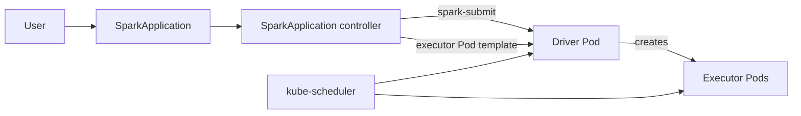
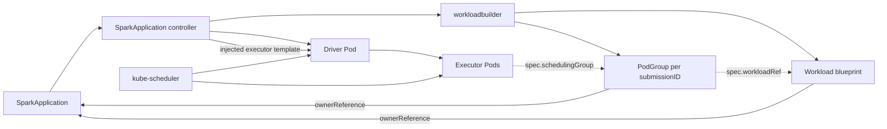
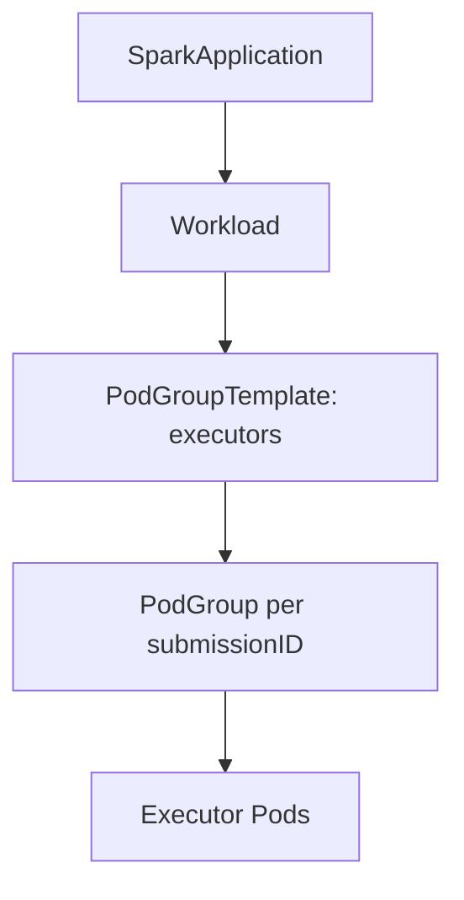
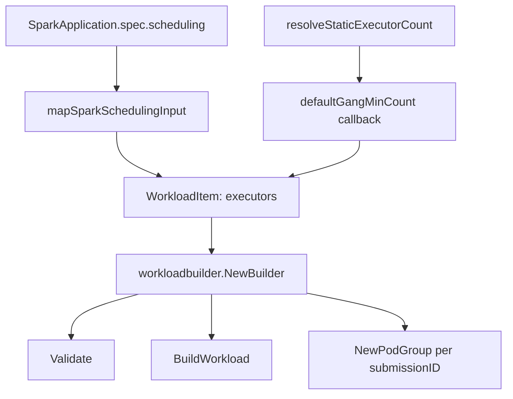
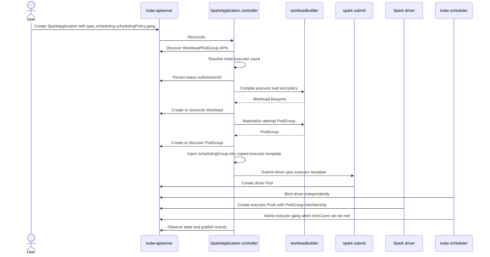
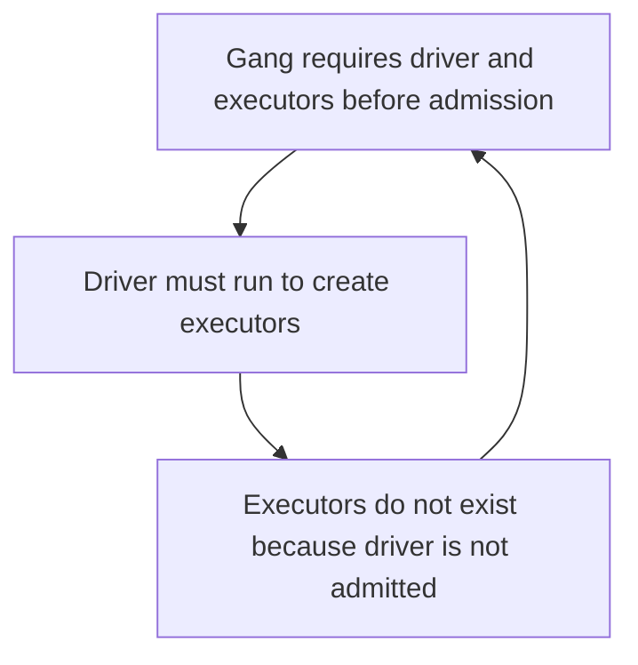
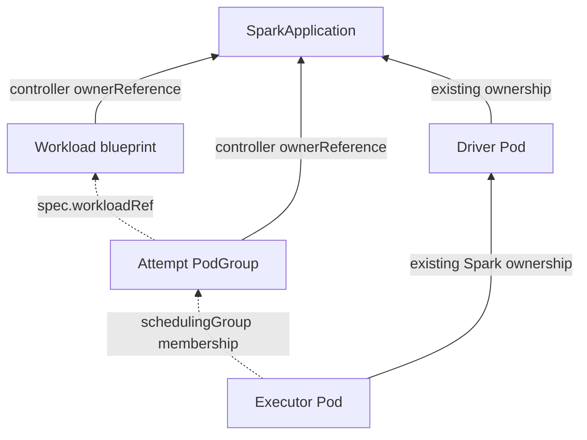
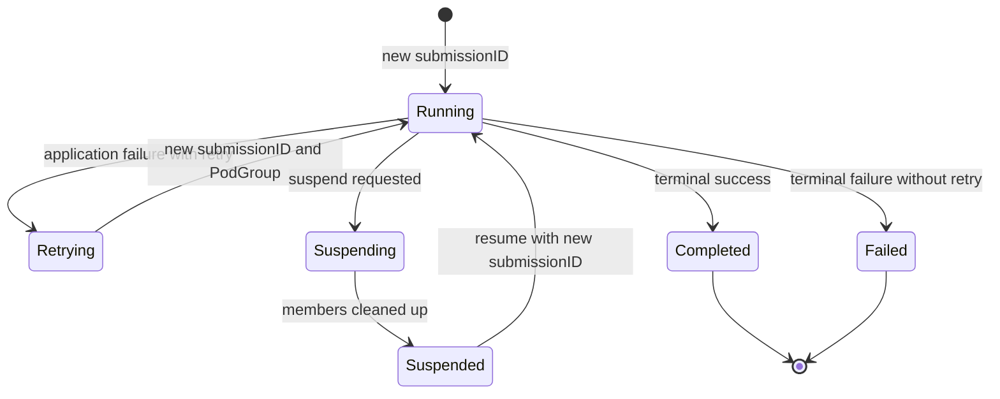

# KEP-2962: Workload-Aware Scheduling for SparkApplication

## Table of Contents

- [Summary](#summary)
  - [Alpha scope](#alpha-scope)
- [Motivation](#motivation)
  - [Goals](#goals)
  - [Future Goals](#future-goals)
  - [Non-Goals](#non-goals)
- [Proposal](#proposal)
  - [User Stories](#user-stories)
- [Design Details](#design-details)
  - [Kubernetes Workload API Overview](#kubernetes-workload-api-overview)
  - [Executor Template Injection](#executor-template-injection)
  - [API](#api)
  - [Scheduling surface unification](#scheduling-surface-unification)
  - [Native WAS activation](#native-was-activation)
  - [Defaulting](#defaulting)
  - [Validation](#validation)
  - [Controller Integration](#controller-integration)
  - [Controller Workflow](#controller-workflow)
  - [Driver/Executor Bootstrap](#driverexecutor-bootstrap)
  - [Attempt teardown](#attempt-teardown)
  - [WorkloadSchedulingReady condition](#workloadschedulingready-condition)
  - [Naming Conventions](#naming-conventions)
  - [OwnerReferences Relationship](#ownerreferences-relationship)
  - [Workload Lifecycle](#workload-lifecycle)
  - [Attempt replacement transaction](#attempt-replacement-transaction)
  - [Post-admission executor replacement](#post-admission-executor-replacement)
  - [Static Executor Count](#static-executor-count)
  - [Compatibility with Existing Integrations](#compatibility-with-existing-integrations)
  - [API Evolution and Phase 0 Pin](#api-evolution-and-phase-0-pin)
  - [Feature Gate Dependencies](#feature-gate-dependencies)
  - [Open Questions](#open-questions)
- [Test Plan](#test-plan)
- [Graduation Criteria](#graduation-criteria)
- [Future Plans](#future-plans)
- [Implementation History](#implementation-history)
- [Alternatives](#alternatives)

## Summary

This document proposes integrating the Kubernetes Workload API into Kubeflow Spark Operator to enable native workload-aware scheduling for `SparkApplication`. The Workload API provides:

- [Gang scheduling](https://github.com/kubernetes/enhancements/tree/master/keps/sig-scheduling/4671-gang-scheduling) (KEP-4671)
- [Topology-aware scheduling](https://github.com/kubernetes/enhancements/tree/master/keps/sig-scheduling/5732-topology-aware-workload-scheduling) (KEP-5732)
- [DRA](https://github.com/kubernetes/enhancements/tree/master/keps/sig-scheduling/5729-resourceclaim-support-for-workloads) (KEP-5729)
- Other features through `Workload` and `PodGroup` resources defined in
[KEP-6089](https://github.com/kubernetes/enhancements/tree/master/keps/sig-scheduling/6089-was-controller-apis)

An optional `.spec.scheduling` is the application-level scheduling surface:

- `schedulingPolicy` — native WAS (Basic/Gang) for executors; one Workload + attempt PodGroup when the feature gate is on
- `batchScheduler` — Volcano / YuniKorn / scheduler-plugins (first-class; not translated to WAS)

`schedulingPolicy` and `batchScheduler` are mutually exclusive (CEL). Dual support keeps top-level `batchScheduler*`. Pod `schedulerName` stays on driver/executor. Details: [Scheduling surface unification](#scheduling-surface-unification).

### Alpha scope

Narrow MVP before dynamic allocation, topology, and client modes (tracking [#2962](https://github.com/kubeflow/spark-operator/issues/2962)):

- cluster-mode, static executors only
- one executor `PodGroupTemplate`; controller-owned Workload + attempt PodGroup; controller-computed `minCount`
- driver **outside** the executor gang (avoids deadlock); `WorkloadSchedulingReady` distinguishes driver Running from gang not ready
- Volcano/YuniKorn remain for multi-app admission; native WAS does not replace them

Provisional. Open decisions: [Open Questions](#open-questions).

## Motivation

Spark Operator users who need gang scheduling today choose an external integration such as Volcano, YuniKorn, or scheduler-plugins. Those integrations remain useful, but they have provider-specific APIs and installation requirements. They stay first-class. Native WAS does not replace them.

`GenericWorkload` is beta and disabled by default in Kubernetes v1.37, and managed Kubernetes providers generally do not expose non-default feature gates. Native WAS is therefore available first to platform teams that run their own control planes and can enable the required gates. That availability limit is a reason to keep the feature opt-in, not a reason to skip the design.

The SparkApplication controller is the KEP-6089 **root controller**: it already knows role, scale, attempt ID, template, and lifecycle. Prototypes [#3093](https://github.com/kubeflow/spark-operator/pull/3093), [#3113](https://github.com/kubeflow/spark-operator/pull/3113), [#3116](https://github.com/kubeflow/spark-operator/pull/3116) proved injection is possible but used shapes we must not freeze into the CRD.

### Goals

1. Add `.spec.scheduling` for native WAS (`schedulingPolicy`) and batch backends (`batchScheduler`).
2. Compose KEP-6089 leaves via Spark-owned types + upstream `workloadbuilder`.
3. SparkApplication controller owns the Workload and attempt PodGroup.
4. Cluster-mode: one Basic/Gang executor PodGroup; driver schedules independently.
5. Controller-computed Gang `minCount` from the same resolver as `spark-submit`.
6. New attempt PodGroup per `status.submissionID`.
7. Nil `.spec.scheduling` / omitted native WAS preserves current behavior; batch dual support as specified.
8. Same validation on `ScheduledSparkApplication.spec.template`.

### Future Goals

1. Dynamic-allocation semantics (separate KEP).
2. Topology, DRA, disruption as upstream APIs mature.
3. Client / in-cluster-client modes after template-path validation.
4. Deeper Kueue coordination.
5. Multi-leaf / CompositePodGroup when needed (wrapper stays extensible; not in alpha).

### Non-Goals

1. Translate batch backends ↔ native WAS (XOR only; no bridge).
2. Put the cluster-mode driver in the executor gang.
3. User-managed `schedulingGroup` on the Spark CRD.
4. User-supplied Gang `minCount` in alpha (Spark scale is source of truth).
5. Dynamic allocation with native WAS in this KEP.
6. CPG / multi-executor-gang **behavior** in alpha (API stays extensible). Follows

   nabuskey: not useful while Spark has one executor group; do not implement in alpha despite
   requests to pull CPG forward.
7. Native WAS for `SparkConnect`.
8. A Spark-specific `workloadbuilder` fork.
9. Superseded WAS shapes (`v1alpha1` inline podGroups, Pod `workloadRef`).
10. Cluster-wide multi-app admission (keep Volcano/YuniKorn for that).
11. `PartialRestart` + native WAS together in alpha.

## Proposal

Native WAS path (when `nativeWASActive`; see [activation](#native-was-activation)): one Workload,
one attempt PodGroup, inject `schedulingGroup` into a deep-copied executor template, then
cluster-mode submit. Scheduling-surface rules: [unification](#scheduling-surface-unification).

Principles:

1. **One scheduling surface** under `.spec.scheduling` → [unification](#scheduling-surface-unification).
2. **One Workload, one executor leaf in alpha** (CPG deferred).
3. **One PodGroup per** `submissionID`**.**
4. **Controller-computed** `minCount` (no user `gang.minCount` in alpha).
5. **Driver outside the gang**; operator owns Workload/PodGroup.
6. **Spec changes invalidate**; replacement → [transaction](#attempt-replacement-transaction).
7. **KEP-6089 types +** `workloadbuilder`; Spark-owned wrappers until Phase 0 pins imports.
8. **No silent fallback** → injection, [validation](#validation) webhook checks, [teardown](#attempt-teardown).

### User Stories

| User need                            | Behavior                                                                                  |
| ------------------------------------ | ----------------------------------------------------------------------------------------- |
| Gang-schedule initial executors      | `schedulingPolicy.gang: {}` with static `executor.instances`; controller sets `minCount`. |
| Insufficient cluster capacity        | Executors stay unbound until the gang admits; no per-Pod fallback.                        |
| Keep ordinary Spark apps unchanged   | Omitted `scheduling` creates no WAS objects.                                              |
| Keep batch backends first-class      | Nested `scheduling.batchScheduler` (dual-support top-level); XOR with native WAS.         |
| Retry without mixing attempts        | Each new `submissionID` gets a new PodGroup.                                              |
| Suspend and resume cleanly           | Suspend deletes the attempt PodGroup; resume creates a new submission ID.                 |
| Reject dynamic allocation            | Typed or `sparkConf` dynamic allocation with native WAS is rejected.                      |
| ScheduledSparkApplication safety     | Webhook validates `spec.template`; each child owns its own objects.                       |
| Gang never admits                    | Driver may be Running while executors stay unschedulable; no silent per-Pod fallback.    |
| Orchestrator visibility              | Airflow-style tasks must not treat driver-only Running as fully started.                 |
| Gang admission deadline              | If the gang never admits, the attempt fails after a configurable deadline.               |

#### Story: Static executor gang for Spark Pi

As a Spark user, I want four initial executor Pods admitted together. If only three slots are available, none of the executors should bind until capacity is sufficient.

```yaml
apiVersion: sparkoperator.k8s.io/v1beta2
kind: SparkApplication
metadata:
  name: spark-pi
spec:
  type: Scala
  mode: cluster
  sparkVersion: "4.0.0"
  image: spark:4.0.0
  mainClass: org.apache.spark.examples.SparkPi
  mainApplicationFile: local:///opt/spark/examples/jars/spark-examples.jar
  scheduling:
    schedulingPolicy:
      gang: {}
  driver:
    cores: 1
    memory: 1g
  executor:
    instances: 4
    cores: 1
    memory: 1g
```

When the feature gate is enabled, the controller creates:

```yaml
apiVersion: scheduling.k8s.io/v1beta1
kind: Workload
metadata:
  name: spark-pi-<stable-hash>
  ownerReferences:
    - apiVersion: sparkoperator.k8s.io/v1beta2
      kind: SparkApplication
      name: spark-pi
      controller: true
spec:
  controllerRef:
    apiGroup: sparkoperator.k8s.io
    kind: SparkApplication
    name: spark-pi
  podGroupTemplates:
    - name: executors
      schedulingPolicy:
        gang:
          minCount: 4
---
apiVersion: scheduling.k8s.io/v1beta1
kind: PodGroup
metadata:
  name: spark-pi-executors-<attempt-hash>
  ownerReferences:
    - apiVersion: sparkoperator.k8s.io/v1beta2
      kind: SparkApplication
      name: spark-pi
      controller: true
spec:
  workloadRef:
    workloadName: spark-pi-<stable-hash>
    templateName: executors
  schedulingPolicy:
    gang:
      minCount: 4
```

The ephemeral executor template sent to Spark contains:

```yaml
spec:
  schedulingGroup:
    podGroupName: spark-pi-executors-<attempt-hash>
```

#### Story: Gang never admits

Four executors, gang never admits: no per-Pod fallback; `WorkloadSchedulingReady=False`; past the admission deadline the attempt fails and cleans up.

#### Story: Orchestrator visibility

Airflow-style sensors must key off `WorkloadSchedulingReady` (or equivalent), not driver Running alone. Putting the driver in the gang is not an option (deadlock).

#### Story: Retry uses a new submission

Retry = new `submissionID` + new PodGroup (not an in-place driver restart).

## Design Details

### Kubernetes Workload API Overview

Kubernetes WAS separates a workload's logical definition from each running group:

- A `Workload` is a controller-produced blueprint with one or more `PodGroupTemplate` leaves.
- A `PodGroup` is a runtime instance materialized from one template for one submission attempt.
- Executor Pods reference the runtime `PodGroup` through native `spec.schedulingGroup`.
- `ownerReferences` express controller ownership and garbage collection; `schedulingGroup` expresses
scheduler membership only.



Native WAS adds scheduler-facing objects compiled by the operator:



Alpha scope maps one executor cohort to one leaf:



### Executor Template Injection

The operator does not create executor Pods; membership must travel in the executor template.

1. Deep-copy the template (do not mutate stored spec); set `schedulingGroup.podGroupName`.
2. Pass it through spark-submit and/or the REST submitter.
3. Driver creates executors (Fabric8 today). Phase 0: verify the Spark/Fabric8 path preserves `schedulingGroup`; otherwise that Spark version is unsupported for native WAS.

Defense (no silent fallback):

1. **Webhook** stamps membership at CREATE (`failurePolicy: Fail` required for native WAS).
2. **Post-create check:** on `ExecutorMembershipMissing`, set `WorkloadSchedulingReady=False` and

   delete bad executor Pods. If membership stays wrong, run
    [Attempt teardown](#attempt-teardown) (stop driver so it cannot recreate bad executors), then
    terminal `Failed` with the same non-retry rules as the admission deadline.

Reject user-authored `schedulingGroup` on the stored template. Cover spark-submit file and REST inline paths. Phase 0: confirm whether `schedulingGroup` is mutable after create (if not, fix path is delete/recreate only).

### API

Target wire shape (native WAS **or** batch backend — not both):

```yaml
# Native WAS
spec:
  scheduling:
    schedulingPolicy:
      gang: {}    # or basic: {}

# Batch backend
spec:
  scheduling:
    batchScheduler:
      name: volcano          # volcano | yunikorn | kube-scheduler names
      queue: default
      priorityClassName: high
      resources: {}
```

```go
type SparkApplicationSpec struct {
    // +optional
    Scheduling *SparkApplicationSchedulingConfiguration `json:"scheduling,omitempty"`
    // Top-level batch fields: dual support only. Prefer scheduling.batchScheduler.
    // +optional
    BatchScheduler *string `json:"batchScheduler,omitempty"`
    // +optional
    BatchSchedulerOptions *BatchSchedulerConfiguration `json:"batchSchedulerOptions,omitempty"`
}

// +kubebuilder:validation:XValidation:rule="!(has(self.schedulingPolicy) && has(self.batchScheduler))",message="schedulingPolicy and batchScheduler are mutually exclusive"
type SparkApplicationSchedulingConfiguration struct {
    // Native WAS policy for the single executors leaf.
    // +optional
    SchedulingPolicy *WorkloadPodGroupSchedulingPolicy `json:"schedulingPolicy,omitempty"`
    // Batch backend (volcano/yunikorn/kube-scheduler). Merges name + options.
    // +optional
    BatchScheduler *SchedulingBatchScheduler `json:"batchScheduler,omitempty"`
}

type SchedulingBatchScheduler struct {
    // +optional
    Name *string `json:"name,omitempty"`
    // +optional
    Queue *string `json:"queue,omitempty"`
    // +optional
    PriorityClassName *string `json:"priorityClassName,omitempty"`
    // +optional
    Resources corev1.ResourceList `json:"resources,omitempty"`
}

// +kubebuilder:validation:XValidation:rule="!(has(self.basic) && has(self.gang))",message="basic and gang are mutually exclusive"
type WorkloadPodGroupSchedulingPolicy struct {
    // +optional
    Basic *BasicSchedulingPolicy `json:"basic,omitempty"`
    // Empty in alpha; controller sets minCount.
    // +optional
    Gang *GangSchedulingPolicy `json:"gang,omitempty"`
}

type BasicSchedulingPolicy struct{}
type GangSchedulingPolicy struct{}

type SparkApplicationStatus struct {
    // existing fields...
    // +optional
    // +listType=map
    // +listMapKey=type
    Conditions []metav1.Condition `json:"conditions,omitempty"`
}
```

Alpha serves one executor leaf (`schedulingPolicy`). Wrapper stays a struct for later multi-leaf/CPG.
Condition contract: [WorkloadSchedulingReady](#workloadschedulingready-condition).
Pod `schedulerName` is unchanged. Runtime objects use `scheduling.k8s.io/v1beta1` (Phase 0 pin).
Reject: dynamic allocation + WAS; user `gang.minCount`; WAS + any `batchScheduler*`.
Do not expose user `schedulingGroup` on the CRD.

API PRs ([#3230](https://github.com/kubeflow/spark-operator/pull/3230)+) must regenerate CRDs/OpenAPI/docs.

### Scheduling surface unification

Per [nabuskey](https://github.com/kubeflow/spark-operator/pull/3154#issuecomment-6370431280): one
`.spec.scheduling` home for WAS and batch backends (not "legacy"). Pod `schedulerName` unchanged.

1. **API:** `schedulingPolicy` + nested `batchScheduler{name,queue,priorityClassName,resources}`; CEL XOR.
2. **Dual support** then deprecate top-level (table below).
3. **Native WAS** behind the feature gate when native WAS is active (see activation).
4. **Docs** use nested `scheduling.batchScheduler`.

`--default-batch-scheduler` only if neither batch form nor native WAS is active.
`batchScheduler.name` allows volcano / yunikorn / kube-scheduler profile names.

**Top-level** `batchScheduler`* **migration** (versions filled when nested API merges as release **N**).
Alpha pin: **retain** the top-level fields on `v1beta2` until a **new API version** ships with conversion. Do not drop, ignore, or no-op-read them while still on `v1beta2`.

| Phase | Release | Read | Write | Storage / rollback |
| --- | --- | --- | --- | --- |
| Dual | N (nested ships) | Prefer nested if set; else top-level | Accept either; **reject** if both set | Persist exactly what the user wrote; no auto-copy either direction |
| Warn | N | Same | Same + Warning on top-level create/update | Unchanged; rollback to N−1 still understands top-level |
| Docs-only nested | N | Same | Same | Examples/docs show nested only |
| Deprecate (still on v1beta2) | N+2 | Same | Top-level still accepted + Warning | Fields remain in the `v1beta2` schema; stored top-level keeps working |
| Remove | New API version only (e.g. v1beta3/v1) | Via conversion from top-level → nested | Top-level absent from new version | Conversion webhook/strategy required; `v1beta2` may stay readable until that version is retired |

No silent conversion between batch backends and native WAS at any phase.

### Native WAS activation

Two predicates (evaluated **after** defaulting). Never key WAS off raw `scheduling != nil`
(nested `batchScheduler` lives under `scheduling` too).

```text
nativeWASRequested =
  spec.scheduling != nil
  && scheduling.batchScheduler == nil
  && top-level batchScheduler/batchSchedulerOptions unset
  && scheduling.schedulingPolicy != nil

nativeWASActive =
  nativeWASRequested
  && SparkApplicationWorkloadAwareScheduling enabled
```

| Predicate | Used for |
| --- | --- |
| `nativeWASRequested` | Admission/reconcile rejection when the gate is off; XOR / conflict checks that mean "user asked for WAS" |
| `nativeWASActive` | Workload/PodGroup create, membership defense, webhook preflight, `WorkloadSchedulingReady` |

### Defaulting

Order: apply defaults → evaluate `nativeWASRequested` / `nativeWASActive` → admit/reconcile.

- `scheduling == nil`: not requested; top-level batch / `--default-batch-scheduler` as today.
- `scheduling.batchScheduler` set: batch path only; do **not** default `schedulingPolicy`.
- `scheduling: {}` (no batch child, no top-level batch): default `schedulingPolicy.basic: {}`
so `nativeWASRequested` becomes true (and `nativeWASActive` if the gate is on). Basic vs Gang
for empty block = OQ1; the requested/active split is not open.
- Explicit `gang: {}`: controller computes `minCount` from resolved executor count.

### Validation

| Configuration                                | Result                                 | Reason                          |
| -------------------------------------------- | -------------------------------------- | ------------------------------- |
| `scheduling` omitted                         | Accept                                 | Backward compatible.            |
| Empty `scheduling: {}` (no batch child)      | Accept; default `basic: {}` → `nativeWASRequested` | See activation; OQ1 = Basic vs Gang only. |
| `scheduling.batchScheduler` only             | Accept; existing batch path            | First-class backend under scheduling. |
| Top-level `batchScheduler*` only             | Accept during dual support             | Preserve current manifests.     |
| Top-level **and** nested batch fields        | Reject                                 | No ambiguous precedence.        |
| `schedulingPolicy` + `scheduling.batchScheduler` | Reject (CEL)                       | XOR; no silent translation.     |
| `schedulingPolicy` + top-level `batchScheduler*` | Reject                            | Same XOR across old/new fields. |
| `schedulingPolicy.gang` without `minCount`   | Accept; controller computes `minCount` | Spark scale is source of truth. |
| User sets `gang.minCount`                    | Reject                                 | Not on alpha CRD.               |
| Both Basic and Gang set                      | Reject                                 | Policy is a union.              |
| Native WAS + dynamic allocation              | Reject                                 | Requires separate KEP.          |
| User sets `spec.schedulingGroup`             | Reject                                 | Operator-managed per attempt.   |
| Non-default / non-WAS scheduler name with WAS | Reject                                | Conflicts with native WAS.      |
| Typed `driver`/`executor.schedulerName` conflict with WAS | Reject                   | Pod-level fields stay; still conflict-checked. |
| `maxPendingPods` below Gang `minCount`       | Reject                                 | Gang can never become ready.    |
| `PartialRestart` enabled with native WAS     | Reject at admission; see below         | Mutually exclusive in alpha.    |
| Unsupported topology, disruption, or claims  | Reject by allow-list                   | Fail closed.                    |
| Feature gate disabled + `nativeWASRequested` | Reject admission; reconcile backstop | Requested ≠ active; gate must be on. |
| Webhook preflight fail + `nativeWASActive` | Reject / fail closed                 | Membership defense requires webhook. |
| Required Kubernetes APIs not served (WAS)    | Reject at reconcile preflight          | Cached API discovery.           |
| Client or in-cluster-client mode + WAS       | Reject until supported                 | Unverified injection path.      |
| `ScheduledSparkApplication` template invalid | Reject the schedule                    | Fail before child creation.     |

**Gates:** wire `--feature-gates` on webhook **and** controller (kept in sync); controller also
re-validates at reconcile. Native WAS requires the pod webhook (`failurePolicy: Fail`).

**Webhook fail-closed preflight** (alpha pin): before creating Workload/PodGroup or submitting when
`nativeWASActive`, the controller must pass **all** of these checks (no vague "Ready condition"):

1. The operator's `MutatingWebhookConfiguration` for Spark pods exists.
2. The relevant webhook rule has `failurePolicy: Fail`.
3. Namespace/object selectors match the target SparkApplication pods.
4. The webhook `clientConfig` Service exists in the expected namespace.
5. That Service has at least one ready EndpointSlice endpoint.
6. Controller RBAC needed for the above GETs is installed.

If any check fails → do not submit; set `WorkloadSchedulingReady=False` reason
`WebhookUnavailable`. Do not rely on Helm values alone.

**Updates:** `.spec.scheduling` / static executor-count changes go through normal invalidation
(not mid-attempt mutate). Replacement of attempt resources follows
[Attempt replacement transaction](#attempt-replacement-transaction).

**Scheduler names with WAS:** typed `driver`/`executor.schedulerName` and sparkConf
`spark.kubernetes[.driver|.executor].scheduler.name` — alpha allows empty/`default-scheduler`
only; long-term: scheduler must serve WAS. Reject `maxPendingPods` < Gang `minCount`.

**PartialRestart +** `schedulingPolicy`**:** reject at admission; disable PartialRestart
skip-invalidation so webhook-only field updates invalidate.

### Controller Integration

`workloadbuilder` compiles one executor leaf from user policy plus controller-supplied structure:



The operator creates one `workloadbuilder.WorkloadItem` for the executor cohort:

```go
func mapSparkSchedulingInput(
    cfg *SparkApplicationSchedulingConfiguration,
) workloadbuilder.WorkloadInput {
    if cfg == nil {
        return workloadbuilder.WorkloadInput{}
    }
    return workloadbuilder.WorkloadInput{
        Policy: workloadbuilder.PolicyInput{
            PodGroupData: cfg.SchedulingPolicy,
            PathElements: []string{"schedulingPolicy"},
        },
    }
}

resolved := resolveStaticExecutorCount(app)

executorItem := &workloadbuilder.WorkloadItem{
    Name: "executors",
    DefaultConfig: &workloadbuilder.SchedulingConfig{
        Policy: &workloadbuilder.SchedulingPolicy{
            Basic: &workloadbuilder.BasicSchedulingPolicy{},
        },
    },
    Input: mapSparkSchedulingInput(app.Spec.Scheduling),
    Callbacks: []workloadbuilder.SchedulingConfigFunc{
        defaultGangMinCount(resolved.InitialExecutors),
    },
}

builder := workloadbuilder.NewBuilder(executorItem, workloadbuilder.BuildOptions{
    Name:      workloadName(app),
    Namespace: app.Namespace,
    Owner:     sparkApplicationOwnerReference(app),
    AllowedPolicies: []workloadbuilder.SchedulingPolicyOption{
        workloadbuilder.BasicPolicy,
        workloadbuilder.GangPolicy,
    },
})

allErrs := builder.Validate(ctx, field.NewPath("spec", "scheduling"), workloadbuilder.ValidationInput{})
workload, err := builder.BuildWorkload()
podGroup, err := builder.NewPodGroup(attemptPodGroupName(app), "executors")
```

Phase 0 pins the exact API and `workloadbuilder` versions before implementation.

### Controller Workflow



For each new submission attempt:

1. After defaulting, evaluate `nativeWASRequested` / `nativeWASActive` (not raw `scheduling != nil`).
2. If `nativeWASRequested` and the gate is off → reject / backstop (do not create WAS objects).
3. If `nativeWASActive`: verify served Workload/PodGroup APIs and webhook preflight.
4. Reject scheduler-name / user `schedulingGroup` conflicts.
5. Resolve initial executor count with the same resolver used for `spark-submit`.
6. Persist `status.submissionID` **before** creating attempt resources. This is an intentional change from today's path, which mints the ID in memory and only persists it after submit returns. The early status write needs its own conflict handling.
7. Build or reconcile the long-lived `Workload`.
8. Materialize or discover the current attempt `PodGroup`.
9. Deep-copy the executor template and inject `schedulingGroup.podGroupName` for both spark-submit template files and the REST submitter's inline templates.
10. Submit the driver through the existing cluster-mode path.
11. Update `WorkloadSchedulingReady` / Events; GC stale attempt PodGroups (submission-id ≠ current; no members).
12. Admission deadline exceeded or persistent membership miss → [Attempt teardown](#attempt-teardown).

No silent Gang → per-Pod fallback.

### Driver/Executor Bootstrap

In cluster mode, putting the driver and executors in one gang deadlocks because the driver must run before executor Pods exist:



Alpha: driver independent; executors in one Basic/Gang PodGroup. Expose `WorkloadSchedulingReady`
when the gang is not admitted (orchestrators must not treat driver Running as "fully started").

**Admission deadline** (numeric default = Open Question 4):

| Topic     | Alpha                                                                                              |
| --------- | -------------------------------------------------------------------------------------------------- |
| Config    | Operator/Helm only (no per-app field in alpha)                                                     |
| Clock     | Starts when driver becomes Running                                                                 |
| On exceed | Run [Attempt teardown](#attempt-teardown), then `Failed` / `ExecutorGangAdmissionDeadlineExceeded` |
| Retries   | **Non-retryable for all** `RestartPolicy` **values**, including `OnFailure` / `onFailureRetries`   |
| Why       | Capacity will not appear from another driver submission; retries only burn driver re-acquire       |

Alpha pins: deadline exceed is a **terminal attempt failure** — do not decrement/consume
`onFailureRetries`, do not enter `PENDING_RERUN` for this reason. Operator-initiated invalidate /
user edit can still start a new attempt later.

Inter-app starvation remains; keep Volcano/YuniKorn for multi-app admission.

### Attempt teardown

Used for admission-deadline exceed and persistent `ExecutorMembershipMissing`. Order is mandatory
so the driver cannot keep creating executors that block PodGroup deletion:

1. Set `WorkloadSchedulingReady=False` with the appropriate reason (do not mark terminal app state yet).
2. Stop/delete the driver Pod (and any operator-owned driver resources for this attempt).
3. Delete malformed / all current-attempt executor Pods.
4. Wait until the attempt PodGroup has no members (respect deletion protection).
5. Delete the attempt PodGroup.
6. Only then transition the SparkApplication to terminal `Failed` with the failure reason/message.

Preserve the Workload blueprint. Same non-retry rules as the admission deadline.

### WorkloadSchedulingReady condition

Alpha adds a standard condition on `SparkApplication.status.conditions` (new field; same pattern
as other Kubeflow operators). Type string is exact: `WorkloadSchedulingReady`.

| Field | Alpha contract |
| --- | --- |
| `type` | `WorkloadSchedulingReady` |
| `status` | `True` when executor PodGroup is admitted (Basic: members can schedule; Gang: `minCount` met) |
| `status` | `False` while pending, webhook unavailable, membership missing, or deadline exceeded |
| `status` | Absent / not set when `nativeWASRequested` is false |
| `reason` | One of: `ExecutorGangPending`, `ExecutorGangAdmitted`, `ExecutorMembershipMissing`, `ExecutorGangAdmissionDeadlineExceeded`, `WebhookUnavailable`, `WorkloadConflict` |
| `message` | Human-readable; stable enough for docs/examples |
| `observedGeneration` | Set to `metadata.generation` when updated |
| `lastTransitionTime` | Update only when `status` changes |

Orchestrators (Airflow, etc.) must gate "started" on `WorkloadSchedulingReady=True`, not on driver
`Running` alone. Richer PodGroup/Workload mirrors stay beta.

### Naming Conventions

- Workload: `<truncated-app-name>-<stable-hash>`
- PodGroupTemplate: `executors`
- PodGroup: `<truncated-workload-name>-executors-<attempt-hash>`

`<attempt-hash>` is a hash of `status.submissionID`, so restart discovery is reproducible from the persisted submission ID.

The controller also sets `sparkoperator.k8s.io/submission-id` on the attempt PodGroup. Reconciliation identifies objects by controller UID, `spec.controllerRef`, template name, the submission-id label, and `status.submissionID`, not by human-readable names alone.

### OwnerReferences Relationship

The SparkApplication controller sets `ownerReferences` on the `Workload` and `PodGroup`. Executor Pods keep their existing Spark ownership; they reference the attempt PodGroup only through `spec.schedulingGroup`.



Discovery rules:

1. No matching owned object: create it.
2. Exactly one matching owned compatible object: reuse it.
3. More than one match or foreign owner: stop and emit a conflict (`WorkloadConflict`); do not adopt.
4. Exactly one matching owned object with incompatible immutable policy: after invalidation,

   delete that Workload and recreate (do not patch around immutability; do not leave two Workloads).

Every step is idempotent. The controller persists the submission ID first and treats compatible already-existing objects as success after restart.

### Workload Lifecycle

| Event | Workload | PodGroup | Notes |
| --- | --- | --- | --- |
| New opted-in app | Create or discover | Create after submission ID | Inject membership, then submit. |
| Retry | Preserve blueprint | New group per submission ID | New submission, not a driver restart. |
| Static executor-count / compatible scheduling change | Per [transaction](#attempt-replacement-transaction) | Delete old → create new with resolved `minCount` | After invalidation; one ordered path. |
| Scheduling change (immutable Workload conflict) | Delete + recreate Workload | Same transaction | Do not patch around immutability. |
| Gang admission deadline exceeded | Preserve blueprint | Delete in [teardown](#attempt-teardown) | Terminal `Failed` after teardown. |
| Persistent membership missing | Preserve blueprint | Delete in [teardown](#attempt-teardown) | Stop driver first; then fail. |
| `Completed` | Preserve blueprint | Delete after executors gone | Current attempt is finished; not "stale by id". |
| Ordinary terminal `Failed` (non-WAS reasons) | Preserve blueprint | Delete after executors gone | Same cleanup as Completed. |
| Suspend | Preserve blueprint | Delete the attempt PodGroup | API deletion protection waits for members. |
| Resume | Reuse blueprint | New group per submission ID | Fresh submission and driver. |
| Delete SparkApplication | GC via ownerReferences | GC via ownerReferences | Existing deletion behavior. |

`ScheduledSparkApplication` children each own their Workload/PodGroups. Retry/resume = new
`submissionID` + PodGroup. Suspend deletes the attempt PodGroup (deletion protection while members
exist; Workload kept).

### Attempt replacement transaction

Single ordered path for static executor-count changes and invalidated `.spec.scheduling` changes
so Workload blueprint `minCount` and the attempt PodGroup never diverge:

1. Invalidate / terminate the current attempt (stop driver and executors; wait for members to leave).
2. Delete the current attempt PodGroup.
3. Persist the new `status.submissionID` for the next attempt.
4. Update the owned Workload in place **if** the API allows the needed field changes; otherwise

   **delete and recreate** that Workload (never leave two Workloads; never patch around immutability).
5. Create the new attempt PodGroup from the updated Workload with the resolved `minCount`.
6. Inject membership and submit.

Do not update only the runtime PodGroup while leaving a stale Workload template (or the reverse).

### Post-admission executor replacement

Lost executors are replaced from the same template into the **already-admitted** PodGroup and
must not re-block on full `minCount`. Phase 0 verifies upstream semantics; E2E kills one executor
after admission.



### Static Executor Count

One resolver for WAS `minCount` and `spark-submit`:

1. `spec.executor.instances` (wins) else `spark.executor.instances` else default 1 (static).
2. Gang requires ≥1 executor; reject dynamic allocation with native WAS.
3. No user `gang.minCount` in alpha (beta may allow a floor ≤ resolved count).

### Compatibility with Existing Integrations

Surface/XOR/dual-support: [Scheduling surface unification](#scheduling-surface-unification).

- Batch backends: first-class; preferred for multi-app admission WAS alpha lacks.
- No public `batchScheduler: was`; registry hooks OK internally.
- `PartialRestart` ⊕ `schedulingPolicy` forbidden.
- Native WAS needs webhook + shared feature-gates.
- Kueue: separate objects; non-retryable deadline can free quota.
- Client modes / SparkConnect: out of alpha WAS scope.

### API Evolution and Phase 0 Pin

The operator's current `go.mod` predates the v1.37 WAS APIs. Reviewers inspecting
`k8s.io/api` types from older module pins may see a different shape than this KEP targets.
Phase 0 must bump `k8s.io/api`, `client-go`, and `component-helpers` to the v1.37+ stack and
verify the served API before implementation.

| Topic | Superseded (`scheduling.k8s.io/v1alpha1`, ~Kubernetes 1.35) | KEP target (`scheduling.k8s.io/v1beta1`, Kubernetes 1.37+) |
| --- | --- | --- |
| `PodGroup` | Inline in `Workload.spec.podGroups` (immutable list) | Standalone CRD with `status` |
| Pod membership | `pod.spec.workloadRef` + `podGroupReplicaKey` | `pod.spec.schedulingGroup.podGroupName` |
| Retry isolation | `PodGroupReplicaKey` on Pod | New runtime `PodGroup` per `submissionID` |
| Gang `minCount` | Not updatable on inline groups | Mutable on runtime `PodGroup` |
| RBAC | `podgroups` resource not served | `workloads`, `podgroups`, `podgroups/status` |

Implementation must not target the v1alpha1 wire shape visible in the operator's current
`go.mod`. Per-attempt isolation stays as one runtime `PodGroup` per `submissionID` plus
`schedulingGroup` injection, following the KEP-6089 centralized-management model used by Job
and Trainer.

### Feature Gate Dependencies

Spark feature gate:

```text
SparkApplicationWorkloadAwareScheduling=false
```

Disabled by default; `nativeWASRequested` with gate off is rejected; objects are created only when
`nativeWASActive`. Webhook and controller must share `--feature-gates`; controller preflight uses
the concrete checks in [Validation](#validation).
Cluster baseline: Kubernetes **v1.37+** with served Workload/PodGroup (+ `GenericWorkload`).
Phase 0 pins the newest KEP-6089 stack ([#6342](https://github.com/kubernetes/enhancements/pull/6342) when landed).

| Decision | Required Phase 0 result |
| --- | --- |
| Minimum cluster version | Provisionally v1.37. |
| Upstream WAS API pin | Newest KEP-6089 stack available at implementation time. |
| Go modules | Pin matching `k8s.io/api`, `client-go`, and `component-helpers` versions. |
| Served CRDs | `scheduling.k8s.io` **Workload** and **PodGroup** (standalone). |
| Pod membership field | `spec.schedulingGroup` present in pinned `core/v1`. |
| `schedulingGroup` mutability | Confirm CREATE-only vs mutable after create; drives webhook correct vs delete/recreate. |
| Rejected shapes | No dependency on v1alpha1 inline `podGroups` or Pod `workloadRef`. |
| Verification | `workloadbuilder` compiles; client can create/list **PodGroup**; RBAC matches served resources; selected Spark/Fabric8 path preserves `schedulingGroup`; post-admission replacement schedules without re-requiring full `minCount`. |
| Webhook | Native WAS requires webhook enabled + Ready, `failurePolicy: Fail`, feature-gates wired, controller preflight. |
| Admission deadline default | Pin the alpha default timeout value before implementation. |

RBAC when enabled:

```yaml
- apiGroups: ["scheduling.k8s.io"]
  resources: ["workloads", "podgroups"]
  verbs: ["get", "list", "watch", "create", "update", "patch", "delete"]
- apiGroups: ["scheduling.k8s.io"]
  resources: ["podgroups/status"]
  verbs: ["get"]
```

Helm/Kustomize must grant the same when the feature is enabled (standalone PodGroup, 1.37+).

### Open Questions

1. Should empty `scheduling: {}` default to `Basic` or `Gang`? (Activation is fixed; only the

   default policy flavor is open. Proposal: `Basic`.)
2. Is v1.37+ an acceptable minimum cluster version for Phase 0 pinning? (Provisional yes; confirm

   after Phase 0 module bump and API discovery.)
3. Does the selected builder require materializing a Basic runtime PodGroup?
4. What **numeric default** should the executor-gang admission deadline use in alpha?

Resolved (pending objection) — normative text lives in the linked sections only:

- Scheduling surface / XOR / dual support / v1beta2-retain migration → [unification](#scheduling-surface-unification)
- `nativeWASRequested` vs `nativeWASActive` → [activation](#native-was-activation)
- No user `minCount`; controller-derived; regenerate CRDs with API PRs
- Condition schema / `lastTransitionTime` → [condition](#workloadschedulingready-condition)
- Attempt replacement transaction; PartialRestart ⊕ WAS forbidden → [transaction](#attempt-replacement-transaction)
- Membership / deadline → [teardown](#attempt-teardown); webhook checks → [validation](#validation)
- Admission deadline non-retryable → [bootstrap](#driverexecutor-bootstrap); numeric = OQ4
- Post-admission replacement; one executor leaf; **CPG deferred in alpha** (nabuskey; kannon92 thread disposition: defer)
- WAS E2E on dedicated v1.37+ job → [E2E Tests](#e2e-tests)

## Test Plan

### Unit Tests

- API defaulting and validation for Basic, Gang, nested vs top-level batch dual support, XOR conflicts, dynamic allocation rejection, user `minCount` rejection, typed and sparkConf scheduler-name conflicts with WAS, `maxPendingPods` below `minCount`, PartialRestart mutual exclusion, user `schedulingGroup` rejection, feature-gate disabled behavior, and `ScheduledSparkApplication.spec.template` parity.
- Shared allocation resolver tests covering typed instances, `spark.executor.instances`, precedence, invalid values, and drift prevention against generated `spark-submit` arguments.
- `workloadbuilder` compilation, ownerReferences, naming, discovery/reuse, retry isolation, membership injection for spark-submit and REST paths without mutating stored spec, webhook membership stamping, post-create membership check, stale PodGroup cleanup, admission-deadline failure, and nil-scheduling no-op behavior.

### Integration Tests

- Reconcile to Workload and attempt PodGroup.
- Persist `submissionID` before Workload/PodGroup creation, including conflict retries.
- Controller restart after Workload, PodGroup, and driver creation without duplication.
- Orphan/stale PodGroup cleanup when `submission-id` label differs from current `status.submissionID`.
- Retry, suspend/resume, API discovery failure, gate-disabled stored object behavior, and
ScheduledSparkApplication child isolation.
- Membership-missing / deadline: full [teardown](#attempt-teardown) (driver stop before PodGroup delete).
- Webhook feature-gates parity; preflight fails when Service/EndpointSlice/failurePolicy checks fail.
- Admission deadline exceed does not consume `onFailureRetries` / does not enter `PENDING_RERUN`.
- Attempt replacement transaction keeps Workload and PodGroup `minCount` aligned; no dual Workloads.
- `WorkloadSchedulingReady` transitions; `lastTransitionTime` only on `status` change.
- Completed/Failed deletes the current attempt PodGroup after members are gone.
- Gate off + `nativeWASRequested` rejected; nested `batchScheduler` never takes the WAS path.

At least one test must use the actual selected WAS CRDs, not only fake discovery.

### E2E Tests

**CI environment (alpha pin):** default Kind e2e (today's v1.32–v1.35 matrix) does **not** run native
WAS cases. Add a dedicated job + Make target when Phase 0 lands:

| Item | Pin |
| --- | --- |
| Make target | `make e2e-test-was` (or `e2e-test WAS=1`) — separate from default `e2e-test` |
| Kind node image | Kubernetes **v1.37+** image pinned in the job (exact tag at Phase 0) |
| Cluster feature gates | Enable upstream gates required for Workload/PodGroup / `GenericWorkload` (names pinned at Phase 0) |
| WAS APIs | Install/serve `scheduling.k8s.io` Workload + PodGroup CRDs matching the Phase 0 module pin |
| Operator | Build/deploy with `SparkApplicationWorkloadAwareScheduling=true` and webhook `failurePolicy: Fail` |
| CI workflow | Dedicated GitHub Actions job; default e2e matrix stays unchanged |

Cases (run only on that job):

1. Static Gang success with four executors.
2. Insufficient capacity: none bind until capacity is sufficient; no resubmission required; `WorkloadSchedulingReady=False` while the driver may already be Running.
3. Admission deadline: gang never admits after driver Running; [teardown](#attempt-teardown) then non-retryable `Failed`.
4. Basic policy schedules executors independently.
5. Retry isolation across submission IDs.
6. Controller restart without duplicate objects.
7. Suspend/resume with a new PodGroup.
8. Kill one executor after gang admission; replacement schedules without re-blocking on full `minCount`.
9. Completed/Failed attempt deletes the current PodGroup after members are gone.
10. Volcano/YuniKorn/scheduler-plugins regressions remain on the **default** e2e matrix (top-level and nested `batchScheduler`).

## Graduation Criteria

### Alpha

- Feature gate default-off; webhook + controller share `--feature-gates` ([validation](#validation)).
- Cluster-mode Basic/Gang via upstream `workloadbuilder`; activation per [activation](#native-was-activation).
- CRD: `schedulingPolicy` + nested `batchScheduler` (XOR); top-level dual-support per [migration](#scheduling-surface-unification); no user `minCount`.
- Idempotent Workload/PodGroup ownership; persist `submissionID` before create; terminal/Completed PodGroup cleanup per [lifecycle](#workload-lifecycle).
- No silent fallback: injection + webhook checks + [teardown](#attempt-teardown); replacement per [transaction](#attempt-replacement-transaction).
- `WorkloadSchedulingReady` on `status.conditions` ([condition](#workloadschedulingready-condition)).
- Admission deadline non-retryable ([bootstrap](#driverexecutor-bootstrap)); `PartialRestart` ⊕ WAS forbidden.
- Post-admission static replacement without re-requiring full `minCount`.
- Unit, integration, Helm, default e2e, and dedicated WAS e2e job ([E2E](#e2e-tests)) pass.
- Docs: prerequisites, examples, limitations, rollback, orchestrator pitfall, webhook, vs Volcano/YuniKorn.

### Beta

- Upstream APIs used by Spark are beta or stable across supported Kubernetes versions.
- Upgrade, downgrade, feature-disable, and controller-restart paths are tested.
- Required observability supports per-application diagnosis without controller logs, including a richer mirrored `status.workloadScheduling` object when useful.
- Revisit user-supplied Gang `minCount` only as a floor, if Spark scale and WAS scale can stay consistent.
- Revisit PartialRestart coexistence (for example force invalidation on webhook-only field changes) if finer UX is needed.
- Named kube-scheduler profiles that serve WAS may replace the alpha empty/`default-scheduler` simplification.

### GA

- Relevant upstream Kubernetes APIs are GA.
- Spark's user-facing scheduling API and lifecycle semantics are stable.
- Version-skew, rollback, and static scale updates have production evidence.

## Future Plans

See [Future Goals](#future-goals). Static post-admission replacement is in this KEP.

**Implement after acceptance:** (1) CRD + dual support + CEL ([#3230](https://github.com/kubeflow/spark-operator/pull/3230)),
(2) validation / resolver / gates / RBAC, (3) gated WAS path, (4) E2E + docs + top-level deprecation Warnings.

## Implementation History

- 2025-10-22: Tracking issue  [#2962](https://github.com/kubeflow/spark-operator/issues/2962) opened.
- 2025-2026: Prototype work in  [#3093](https://github.com/kubeflow/spark-operator/pull/3093),  [#3113](https://github.com/kubeflow/spark-operator/pull/3113), and  [#3116](https://github.com/kubeflow/spark-operator/pull/3116); credited as evidence, not approved API.
- 2026-09-08: Initial provisional KEP.
- 2026-09-13: Aligned with KEP-6089 `workloadbuilder`, static-only alpha scope, immutable scheduling, and Phase 0 dependency pinning.
- 2026-09-13: Restructured to match the Kubeflow Trainer KEP layout and trimmed duplicate sections.
- 2026-09-17: Clarified v1alpha1 vs v1.37 `v1beta1` API evolution and Phase 0 pin requirements
after community review on PR [#3154](https://github.com/kubeflow/spark-operator/pull/3154).
- 2026-09-21: Incorporated review feedback on availability, alpha `minCount`, failure stories, executor template injection, validation conflicts, naming, suspend deletion, and deferred Kueue and status work.
- 2026-09-26: Documented orchestrator visibility when the driver runs outside the executor gang (Airflow-style misleading "started"), with alpha Events and beta condition requirements.
- 2026-10-06: Incorporated second-round review feedback: alpha `WorkloadSchedulingReady` condition, webhook and post-create membership enforcement, admission deadline, next-submission scheduling changes, PartialRestart mutual exclusion, typed schedulerName conflicts, persist-before-create submissionID and stale PodGroup cleanup, REST injection path, static post-admission replacement, minimal Kueue coexistence, and inter-app starvation limitation.
- 2026-10-12: Added the initial workload-aware scheduling API in [#3230](https://github.com/kubeflow/spark-operator/pull/3230).
- 2026-10-13: Third-round review (condition, webhook/membership, deadline, PartialRestart, etc.).
- 2026-10-29: Scheduling-surface unification (nabuskey).
- 2026-11-10: Rebase to `upstream/master`; de-duplicate / shorten KEP prose.
- 2026-11-11: CR review pins — `nativeWASRequested`/`nativeWASActive`, concrete webhook preflight checks, attempt teardown, replacement transaction, v1beta2-retain migration, condition `lastTransitionTime`, terminal PodGroup cleanup, dedicated WAS e2e job; CPG deferred (nabuskey).

## Alternatives

### Add `minMember` to `batchSchedulerOptions`

Earlier prototypes added a low-level minimum next to provider-oriented options. This mixes Kubernetes-native policy with Volcano queue configuration and cannot grow into KEP-6089 topology, disruption, and DRA building blocks.

### Expose an operator-managed `schedulingGroup` field

PodGroup names are per attempt, not durable user intent. Membership is injected into the ephemeral executor template instead.

### Feature-gate-only automatic behavior

Enabling a controller gate could gang-schedule every SparkApplication automatically. This has no API surface and no Basic escape hatch.

### Include the driver in the gang

Deadlocks in cluster mode because the driver must run before executor Pods exist.

### One PodGroup for every retry

Reusing a PodGroup allows old and new attempt Pods to share scheduler state and makes cleanup ambiguous.

### Use `pod.spec.workloadRef.podGroupReplicaKey` for retry isolation

This fits the superseded `scheduling.k8s.io/v1alpha1` model where `PodGroup` is inline in
`Workload.spec.podGroups` and Pods reference the group through `workloadRef`. Kubernetes 1.37
uses standalone runtime `PodGroup` objects and `spec.schedulingGroup` on Pods;
`PodGroupReplicaKey` is not part of that API. Per-attempt isolation remains one runtime
`PodGroup` per `submissionID`.

### Delegate PodGroup creation to the driver

The operator already owns the template and attempt state; centralized management is smaller for the MVP.

### Write a custom Workload builder

Duplicates KEP-6089 defaulting, validation, and version adaptation already provided by `workloadbuilder`.

### Register native WAS as a `batchScheduler` backend

The operator already has a scheduler registry for Volcano, YuniKorn, and scheduler-plugins. Exposing a public `batchScheduler: was` name would make Kubernetes-native scheduling look like another third-party scheduler and split the API. This KEP keeps `.spec.scheduling` as the only public opt-in. Internally, native WAS may reuse the registry/interface for lifecycle hooks and mutual exclusion without becoming a user-facing backend name.

### Put scheduling under executor or driver fields

A top-level `.spec.scheduling` matches Job and Trainer direction, keeps application-level policy in one place, and documents that alpha scope applies to the executor cohort.
